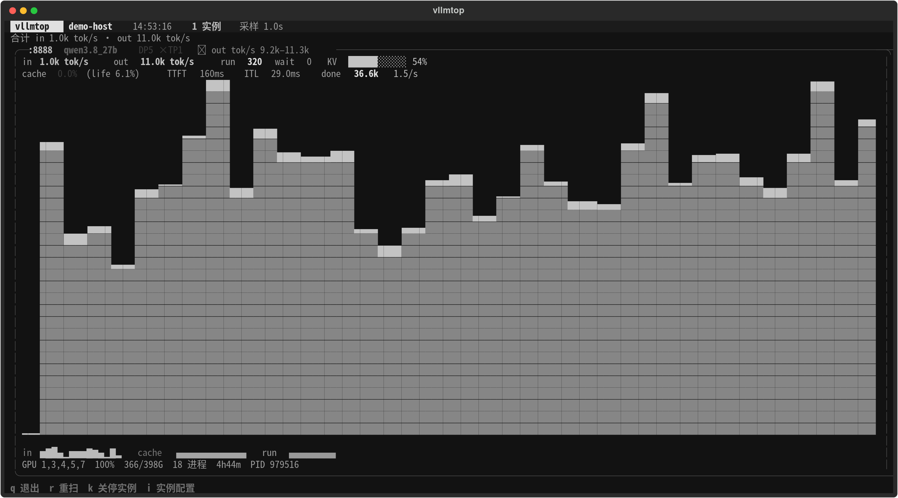

# vllmtop

> nvitop 风格的 vLLM 实例看板：一条命令看本机所有 vLLM 实例的吞吐、cache 命中率、KV cache 和 GPU 占用。

nvitop 管 GPU，vllmtop 管 GPU 上的 vLLM 实例。它自动发现本机所有监听端口上的 vLLM 服务，
把每个实例的实时吞吐、请求队列、KV cache 使用率、prefix cache 命中率、TTFT/ITL、完成请求数和
GPU 占用画在一屏里：



## 特性

- **自动发现**：扫 `/proc/net/tcp{,6}` 的 LISTEN 端口逐个探 `/metrics`，响应里有 `vllm:` 指标才算实例，
  不认进程名——`vllm serve`、`python -m vllm.entrypoints...`、包装脚本启动的都能看到。
- **实时指标**：in/out tok/s、running/waiting、KV cache 使用率、prefix cache 命中率（区间值 + lifetime 值）、
  TTFT / ITL、累计完成请求数与 req/s、GPU util 与显存。
- **自适应布局**：实例少时面板占满屏幕，单实例把剩余高度画成 tok/s 历史面积图；实例多了按数量均分高度。
- **配置按需看**：TUI 里按 `i` 或 `vllmtop --info` 查看 `max_model_len`、`max_num_seqs`、`api_server_count`、
  `gpu_mem_util`、`kv_cache_dtype`、`block_size`、KV cache 容量、量化、tool/reasoning parser、权重目录、
  关键环境变量和完整启动命令；`--json` 输出同一份结构给脚本。
- **有界存档**：CSV 按天分文件，默认保留 7 天、总量上限 200MB，超了删最旧的文件；
  `vllmtop --report` 把存档按分钟聚合成表格和曲线，回看整段跑批有没有塌速。
- **只读**：不改任何 vLLM 配置；关停只向 `vllm serve` 主进程发 SIGTERM，认不出主进程的实例不动。

## 安装

需要 Linux（读 `/proc`）。`nvidia-smi` 可选，没有就不显示 GPU 列。

```bash
uv tool install git+https://github.com/AusarPu/vllmtop
# 或者
pipx install git+https://github.com/AusarPu/vllmtop
```

也可以克隆后直接用：

```bash
git clone https://github.com/AusarPu/vllmtop && cd vllmtop
uv sync
uv run python vllmtop.py
# 或者装成命令：ln -s "$PWD/bin/vllmtop" ~/.local/bin/vllmtop
```

## 用法

```bash
vllmtop                      # 默认 TUI：q 退出 / r 重扫 / k 关停实例 / i 实例配置
vllmtop --once               # 打一屏彩色快照就退出
vllmtop --watch 2            # 原地刷新，不占终端全屏
vllmtop --info [PORT]        # 看运行配置（省略 PORT 列出全部实例）
vllmtop --info --json        # 同一份配置输出 JSON
vllmtop --report [CSV ...]   # 读 CSV 存档，输出分钟级汇总与吞吐曲线
vllmtop --kill 8888          # 关停某个实例（--yes 跳过确认）
```

TUI 里 `k` 关停需要两段确认：先选实例，再确认；只对认得出的 `vllm serve` 主进程发 SIGTERM。

## 指标口径

- **in / out tok/s**：采样区间内 `prompt_tokens_total` / `generation_tokens_total` 的差分。
- **cache 命中率**：`Δprefix_cache_hits_total / Δprefix_cache_queries_total`，括号里是启动以来的 lifetime 值；
  lifetime 会把近期命中变化平滑掉，盯跑批看区间值。
- **KV 使用率**：各 DP 副本 `kv_cache_usage_perc` 的平均值。
- **done / req/s**：`request_success_total` 的累计值与区间速率，用来推 ETA。
- **TTFT / ITL**：`time_to_first_token` / `inter_token_latency` 直方图的 `_sum / _count` 区间均值。

## CSV 存档与回看

- 每个实例每个采样一行，按天写到 `logs/vllmtop/vllm-<日期>.csv`（目录可用 `--csv-dir` 改）；
- 默认保留 7 天（`--csv-days`），总量超过 200MB（`--csv-max-mb`）删最旧文件；
- 列格式升级时旧文件自动轮转成 `vllm-<日期>-vN.csv`，已采到的数据不丢；
- `--report` 读目录或文件，输出每个实例的平均/峰值吞吐、平均 run、wait 峰值、cache 均值、
  期间完成请求数，以及按分钟聚合的面积图和明细表，并标出采样中断。

## 限制

- 只能看到**当前网络/PID namespace**里的 vLLM：容器里看不到其它容器的进程，
  `nvidia-smi` 也只把本容器的进程归属到实例上；同卡其它容器的显存不参与展示。
- 依赖 vLLM 的 `/metrics`（Prometheus 文本格式）。非 vLLM 的服务不会被误认成实例。
- 在 Linux + vLLM v1（实测 0.32.0）上开发，其它版本/平台未验证。

## License

MIT
